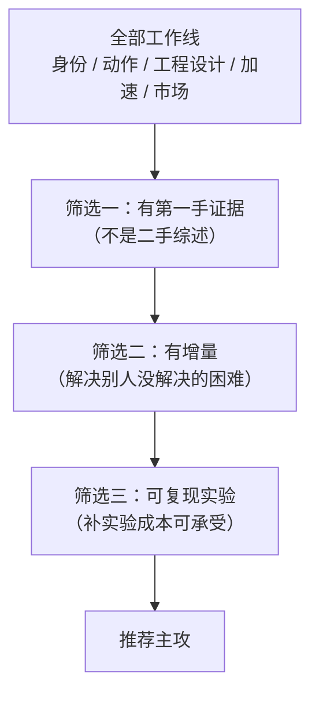

# 数字人方向实习汇报

这次实习的方向是**会议面试官数字人**。要回答的核心问题只有一句：**实时、可控、可插拔的数字人系统怎么做出来。** 下面分五部分：数字人是什么、有哪些路线；实习期间做了哪些工作；我们对这条技术路线本身的理解；领域里真正难的问题在哪；以及基于这些，我们能做什么。

## 一、什么是数字人，有哪些路线

### 数字人与它的两个因素

数字人这件事要分两层看：**数字人模型**回答"给定驱动信号（音频、文本），怎么生成可控的形象"；**数字人系统**是把 ASR、LLM、TTS 与形象渲染串成可对话产品的工程形态。一句话概括：**用可驱动的形象，把语音或文本变成会说话、有表情的画面。**

其中最重要的两个因素是**动作**与**身份**：

- **动作**回答"怎么动"——表情、口型、头姿、手势、身体；
- **身份**回答"长什么样、是不是同一个人"——外观、纹理、几何。

看一个方案好不好，先看它把这两件事分别交给了谁。

### 一条主流路线与两条重要路线

在具体路线之上，还有更高一层的一刀切。**当前领域的主流其实只有一条：数字人基模路线**（视频基模，整帧生成）。它之外还有两条独立路线——**3D 资产（3DGS / NeRF）** 与 **动作潜空间**；其余路线（2D 换嘴、掩码局部多人控制等）都不算主流。

|  | **基模路线（主流）** | **3D 资产（3DGS / NeRF）** | **动作潜空间** |
|---|---|---|---|
| 定位 | 当前领域主流 | 独立一条，专人资产形态 | **我们找到的比较不吃算力的方案** |
| 能力上限 | 最高：全画幅、场景与全身动作一起出，整帧重绘 | 身份可复用、新视角可渲染、几何一致 | 受限：画面由参考外观搬运，工作集中在面部 |
| 算力门槛 | **高——训练通常在数张 A100 量级**，实时化还要额外的蒸馏与加速工程 | 中到高：注册与逐人优化，需多视角数据 | **低，单卡即可闭环** |
| 身份怎么落地 | 长在模型权重或 LoRA 里，不可单独替换 | 训练进资产，换人等于重训 | **换一张参考图即换人** |
| 我们的掌握 | 了解，未深入接入 | 调研过、做过接入与验证 | **最熟，有第一手证据** |
| 就业相关性 | **最高（招聘市场最认这一段）** | 中 | 中 |

我们选动作潜空间，直接原因是**算力门槛**，不是它是主流：它在**单卡上就能形成"调研 → 接入 → 优化 → 治理"的完整闭环**，而基模路线无论是复现还是微调都是数张 A100 的账。代价是画面自由度低一等（第三部分会讲它的四个固有限制）。

而动作潜空间内部，还要再拆成**两个动作**——这一拆是理解整条路线的主干：

- **B1 动作生成**：把语音或文字变成运动。代表：**Ditto 的 265 维**运动空间（尺度、三轴旋转、平移、表情形变，**不含关键点**）、**FLOAT / Avatar Forcing 的 20 维运动子空间**、**LIA-X 的 40D motion code**。
- **B2 渲染器**：把运动套回参考外观出画面。后端包括：**SPADE 系**（LivePortrait，**Ditto 复用的就是这一套**）、**flow-warp + StyleGAN2 风格调制卷积**（LIA-X）、**加法解耦 decoder**（FLOAT / Avatar Forcing，`z = z_S + m_S`）、**FLAME / 3DMM**、**3DGS / NeRF 专人资产**。

**一个必须记住的边界：渲染器契约互不兼容。** Ditto 的 265 维不能喂给 LIA-X 的 40D，也不能喂给 FLOAT 的 `r = Bα`——不是接口不匹配，是**语义对不上**。所以在这个范式里，**换渲染器等于换运动表示**。

### 六条常见路线

| # | 路线 | 动作生成 | 身份呈现 | 优势 / 限制 |
|---|------|---------|---------|------------|
| 1 | 2D talking-head / latent inpainting | 局部换嘴、视频级修正 | 参考图或视频（2D warping） | 简单快、生态成熟 / 身体手势弱、3D 一致性弱 |
| 2 | 结构化动作策略 | 动作空间生成（SMPL-X、FLAME、motion token） | 参数化渲染器 | 可解释可控、动作可单独评估 / 仍需 renderer |
| 3 | 动作扩散 + 快速渲染器 | 动作空间生成（低维 motion + 扩散） | warping GAN 或 renderer | **实时性强、工程闭环清晰** / 画面自由度低于整帧大模型 |
| 4 | 视频基座模型适配 | 整帧视频生成（video latent、DiT） | 参考图条件注入（ReferenceNet、LoRA） | 全画幅表达强 / 训练推理重、资产不可复用 |
| 5 | 3D 资产（学习式 / 参数化装配式） | 动作空间生成（motion、pose、blendshape） | 3DGS、NeRF，或 rigged mesh + 游戏引擎 | 身份可复用、几何一致 / 注册训练成本高或美术成本高 |
| 6 | 掩码局部多人控制 | 整帧视频生成 + 局部控制 | 参考图条件 + 掩码限定说话人 | 可指定说话人 / 依赖 mask、复杂互动未解 |

**我们选的是路线 3**：动作空间生成 + 快速渲染器，代表模型 Ditto 与 Avatar Forcing。

### 两条谱系

**动作表示谱系**（按"人能不能读懂每一项"从高到低）：3DMM 系数（FLAME / BFM）→ blendshape 系数（ARKit 52 维等工业标准）→ 显式关键点（68 点、MediaPipe 468/478 点）→ 部署运动向量（Ditto 265 维）→ 隐式关键点（LivePortrait，无天然语义）→ 整体面部 latent（512 维，容量大但不可编辑）→ 资产接口（SMPL-X / ARKit / BVH，可跨软件）。

谱系两端的取舍很清楚：**显式端**可解释、可逐维编辑、能直接接游戏引擎；**隐式端**容量大、表达上限高，但想改一个"眼神"，得先做实验找出该动哪一维。

**渲染后端谱系**决定身份怎么落地、也决定可替换性。一个具体数据点：LIA-X decoder 在 A10、512²、bf16、batch=1 下约 **333 毫秒/帧**——**渲染器本身就可能是速度瓶颈**，不只是生成模型。

### 评价体系

评价分两层：**评价维度**决定"哪类事情要算进评价"，**评价指标**决定"用哪个数字量去比"。

三个评价维度：**表现质量**（像不像、自然不自然）、**表现范围**（能驱动到哪里）、**工程性能**（能不能用起来）。五族评价指标：**唇同步**（Sync-C / Sync-D）、**身份与长时漂移**（CSIM、CSIM-drift）、**画质**（PSNR / SSIM / LPIPS / NR-IQA）、**时序流畅**（Dino-S、flow smoothness）、**效率**（FPS、TTFF、延迟、显存）。

有一点值得单独指出：**"表现范围"是三个维度里唯一没有被指标体系覆盖的一个**——没有类似 CSIM、Sync-C 那样的通用度量，实践中只能定性描述"能不能驱动手、能不能全身、能不能多人"。这是评价体系自身的空白。

## 二、实习期间做了哪些工作

### 主线五段与时间轴

| 时间 | 节点 |
|------|------|
| 06-01 | 入职，确定数字人方向 |
| 06-08 | 技术方案调研启动（2D talking-head / 3D 高斯头像 / 扩散式生成三条路线） |
| **06-22** | 调研完成：**定下以动作潜空间方案为主**（三条路线初筛后收敛到"动作空间 + 快速渲染器"）；同期评测框架落地（脚手架、核心接口、指标、CLI、报告，**177 项单测通过**） |
| 06-24 | FlashHead 接入、推理链路打通 |
| 07-06 | 并行方向：卡通数字人 / 产品调研 / 评测框架优化 / 模型部署测试 / 对话评测集 |
| 07-09 | 评测能力扩展，FlexAvatar 接入 |
| 07-13 | 竞品调研与选型确认 |
| 07-25 起 | CyberVerse 侧主线：流式接入 → 卡死修复 → 实时性测量 → 编码链路 → 二级修复 → 内存与稳定性 → 实时性改进 |

**这五段的关系**：调研与选型决定方向，接入把模型变成可替换的插件，优化让链路真的能跑，治理解决"跑起来之后质量会漂"。前两段是判断，后三段是工程与实验。

### 五条工作线

每条一句话：**问题 → 方法 → 结果**。

- **身份**：长视频里脸会逐渐漂移 → 先把漂移拆成"模长撑开"与"方向游走"两个假说逐个测 → 模长被否证、方向游走得到单身份支持；推理期锚点引导把 300 秒的身份相似度从 0.645 提到 0.935。
- **动作**：原模型听不懂中文音频，眼嘴也分不开 → 蒸馏桥 + 几何约束 + 关系蒸馏，另把 Ditto 的眼嘴控制拆成四层机制 → 同步指标优于对照锚，并明确"可控性是四层叠出来的"。
- **工程设计**：生成帧是裁剪区域要贴回原画面，还要稳定发出去 → 贴回六阶段设计 + 传输与发布设计 + 音频链路与生命周期兜底 → 丢包隐藏占比从 3.6% 降到 0.022%，会话约 35 秒回收。
- **数字人加速**：GPU 预算只剩几毫秒余量 → 分"生成侧"与"系统侧"两条路径分别压 → Decoder 推理提速 4.2×，首响应从 3.5 秒到 2.9 秒；同时明确"局部变快 ≠ 用户侧变快"。
- **行业全景**：要知道市场做到哪一步、我们处在什么位置 → 五层技术栈 + 开源与产品侧调研 + 未采纳与待复跑清单 → 得出"实时 + 可插拔 3D/扩散模型"这一段是当时缺口。

### 量化成果总表

数字全部来自 `数字人概述/` 各篇与 `总结.md`，逐项标来源；本篇不做二次加工。

| 主题 | 关键数字 | 来源 |
|------|---------|------|
| **身份** | 模长假说被否证（各臂模长近乎恒定）· 方向游走 **+2.1°/min**（峰值离参考 24.8°）· 锚点引导 300 秒相似度 **0.645 → 0.935** · 训练期条件化 v2 同步退化 · 学习式锚力指标更高但人眼头抖 | 数字人身份 |
| **动作** | 桥系列同步指标 **6.299 / 8.853**（对照锚 6.122 / 9.044，多域 257 clips）· 注入点收益 **+0.39** · 全开放 4.565 对纯桥 5.719 对桥内 LoRA 5.483 · 眼嘴控制索引各 5–6 维 | 数字人动作 |
| **工程设计** | 丢包隐藏 **2.5–3.6% → 0.022%** · 发布节奏稳态 **1.000** · 会话 **35 秒**归零、空闲 3 分钟卸载 · 插件每周期残留 **约 1.4 GB** · 进程 RSS **9.8 → 20.5 GB**（基准路径恒 6.6 GB）· 贴回 p95 **67.3 → 12.7 ms**、RTF 0.698 → 0.588、TTFF 1.39 → 1.18 秒、像素 max diff 为 0 | 工程设计 |
| **数字人加速** | GPU **38.5 ms/帧 vs 40 ms 预算（96%）** · Decoder **4.2×** · 首响应 **3.5 → 2.9 秒** · 编码耗时拆解 **679 ms**（进程与初始化约 400 ms 为主）· 大模型方案在 A10 上是 **0.8–0.9 FPS**（主机内存要求 ≥110 GiB） | 数字人加速 |
| **平台资产** | 论文库 **118 篇** · 知识库 **52 个文件** · 概述文档 **11 篇** · 论文笔记 **24 篇** · 共享层回灌项：1 项已回灌、3 项待回灌 | 本仓库 |

### 工作方法沉淀

这一节是给未来的自己用的——哪些做法值得复用。

**任务树管理。** 每项任务写清四件事：**目标、范围、验收标准、非目标**。其中"非目标"最有价值：它挡掉了范围蔓延（例如"性能优化本身"被明确列为非目标，避免一个测量任务悄悄变成调优任务）。进展按时间追加，状态如实标注——**进行中不写成已完成**。

**负结论与正结论同等保留。** 我们手里几条"失败"是有分量的：打断后立即止声**四个版本全被推翻**（画面冻结 / 长度难调 / 尾音被一起丢弃）；训练期参考条件化 v1 干净失败（训练库含答案 + 尾层注入容量不足）、v2 多 seed 回退（同步退化）；还有一次"不可用"的结论被自己的复测推翻（显存不是瓶颈，主机内存才是）。

**证据分级。** 待复跑 → 初步观察 → 已复现 → 已否决，每档规定"能写什么、不能写什么"：只有口头观察就不写分数与排序，避免把印象写成结论。

**探针与消融。** 先审计注入位置，再做消融（把挂载点从"三个轴"改成路径后缀精确匹配，并在训练前打印命中清单，否则消融结果不可信）；隐式表示靠扰动观察反推控制（眼、嘴的控制索引不是模型给的标签，而是逐维扰动看画面变化后建立的映射）；先分层定位瓶颈再决定改哪一层。

**共享脚手架协作。** 通用能力（隐藏项配置、文档系统、列表排序等）标为共享项并登记回灌，避免每个项目重造。

### 我们缓解过的三类问题（都是"变体级"）

这三条不是范式的固有限制（见第三部分），而是**流式化或选型引入**的，我们下场做过：

- **长时运动漂移**：流式化（块滚动 + 把自己的生成当历史 + 无闭环纠偏）引入，漂的是**运动输出**——逐帧运动隐变量的**方向**以 +2.1°/min 持续偏移。我们**已缓解**：推理期锚点引导（约束运动方向）让 300 秒 CSIM 从 0.645 到 0.935，不重训、可开关。**边界**：单身份 300 秒，跨身份未验证。
- **静音放大**：说话时音频是近乎一一对应的强条件、能把轨迹拉回；静音时这层约束消失，缺口由模型自己生成的历史填，同样的偏差更容易累积。**已缓解**：静音期的音频归一化与静音流连续性走工程侧（见 `工程设计`）。**边界**：静音 / 非静音的配对对照还没做。
- **条件注入的可靠性**：必须硬生效的条件不能走可被注意力软忽略的通道——把"进度"这类必须生效的条件从加法注入换成交叉注意力注入后出现伪影。**选型结论**：必须硬生效的条件走**加法 / 拼接**。

## 三、我们对潜动作空间数字人模型的理解

这一部分只回答一个问题：**我们怎么理解这条路线的模型。** 顺序是：它是什么 → 靠什么成立 → 四个固有限制 → 由此推出的判断。

### 它是什么：两级结构

潜动作空间模型把生成拆成两级：**先在低维运动空间里生成"怎么动"，再由渲染器把运动套回参考外观出画面。**

这样切的好处有三个，代价有两个：

| 好处 | 代价 |
|---|---|
| **实时**——算力花在 20 / 265 维而不是像素上，单卡可跑 | **画面靠参考外观搬运**，生成力受源图约束（背景、服饰稳定，但也不会被重新合成） |
| **可控**——维度可读、可逐维扰动建立控制映射 | **工作单元是"裁剪对齐的人脸框"**，所以它只解脸 |
| **身份复用**——换一张参考图就换人 | 换渲染器等于换运动表示（见第四点固有限制） |

### 它靠什么成立：假设"身份与运动可分解"

这一族的全部优点建立在一个假设上：**身份与运动可以分开**——`z = z_S + m_S`（身份项每步恒等）、运动量里**不含关键点**、**身份被钉在渲染入口**。

而"可分解"有两种具体写法，还有第三个维度：

| 写法 | 公式 | 落在哪 |
|---|---|---|
| 隐空间加法 | $z = z_S + m_S$（$z_S$ 512 维每步恒等） | 表示层（FLOAT / Avatar Forcing） |
| 关键点变换 | LivePortrait 式：$x = s\cdot(x_c R + \delta) + t$（**先旋头姿、再加表情**） | 关键点空间 |
| 关键点变换（改次序） | PerformRecast 式：$x = s\cdot((x_c + \delta) R) + t$（**先加表情、再整体旋转**，与 FLAME 一致） | 关键点空间 |

前两行是"两种分解方式"，后两行是"同一种方式里**次序对不对**"。后者的结论是：先旋再加会让表情形变混进头姿信息，"只改表情、不动头"做不到。所以**"可分解"不只是"分成两项"，还要问"两项以什么方式组合"**——次序放错，分解就名存实亡。

### 四个固有限制（范式级：换掉实现也消不掉）

| # | 限制 | 导致什么失败 |
|---|---|---|
| **1** | **只解脸**——工作单元是裁剪对齐的人脸框 | 身体、手、交互几何（看向谁、靠近、前后遮挡关系）、场景变化都不在表示里；**换机位不是移动相机，而是重新生成一段**；多人场景靠"逐框处理 + 贴回"解决（这是正确做法，不是缺陷），代价是**框外画面与框间遮挡不在表示里** |
| **2** | **只能搬运，不能合成**——渲染器把参考外观 warp 出来 | 改不了服饰、背景、光照、场景；大外观变化做不了；源图没观测到的区域（大偏航、被遮挡）只能由解码器"想象"，**几何不保证正确**；本质是**重演**而不是**生成** |
| **3** | **运动侧没有角色条件**——身份只进 decoder，运动生成侧的条件只有音频、情绪标签、源运动、时间步，**没有"这个角色"这一路** | **生成侧塌向均值**：生成的是"谁都能用的平均动作"，而不是"这个人怎么动"（AF 学成被动、不回应的倾听，须靠 DPO 拉回；另一篇工作里听者动作直接塌成静态脸）；**治理侧只能外挂或事后手算**（锚帧库本质是外挂的非参数密度估计，模长 / 方向 / 尺度三条曲线只能自己写脚本测）；**语义级控制要逐维扰动反推** |
| **4** | **隐式运动空间与它的渲染器是一套私有契约**（三层绑定：语义——表示"是什么"由渲染器定；接口——维数 / 基 / 尺度私有；训练耦合——运动编码器与渲染器联合训练） | **换后端 = 换表示**（Ditto 的 265 维不能喂 LIA-X 的 40D）；**不能部件级替换**（升级渲染器要重训运动侧）；**跨模型组合几乎不可能**；**生态碎片化**——领域几乎没有"运动表示的标准接口" |

两条边界必须写明：

- 限制 3 的准确说法是"**运动侧缺角色条件**"——扩散 / 流匹配模型**本身隐式有分布**（score 原则上可算 $-\log p$），所以不能写成"模型没有分布"；缺的是**逐角色**这一层的条件与标定。
- 限制 4 只对**隐式**表示成立——**3DMM 系（FLAME 系数）是弱绑定**，同一组系数可以喂不同后端（这正是它在工业界流通的原因）。**ARKit 52 维 blendshape 之所以能成为标准接口，恰恰因为它独立于任何渲染器。**

限制 3 与 4 合起来是一条取舍：**自由度越语义化就越通用、越可编辑；越隐式就越绑定、越难编辑。** 这是取舍，不是谁的失误。

限制 3 还有一面要点明：**"运动与角色无关"同时是优点和缺点**——正因为如此，**换一张参考图就换人**（最便宜的换身份方式）；代价是**生成的动作不属于任何具体的人**。

另外，还有三类问题**不是**范式限制，而是流式化或选型引入的——长时运动漂移、静音放大、条件被当成同一类处理；它们可以由工程或选型缓解（第二部分已写我们的缓解），所以不列进这张表。

### 由上面的分析推出的判断

**我们的增量位置。** 限制 1 / 2 属于范式边界（要换范式才能解），**限制 3 / 4 才是我们能做的增量**，而限制 3 给了增量一个非常具体的说法：

> **给运动侧补回"角色"这一路条件**——逐角色的运动先验 $p_p(\alpha)$ 就是"这个角色的运动条件"；**不是去改 decoder**。

（一条旁证：语音天然携带音色与说话风格，所以音视频联合生成**天然就给运动侧带了一路角色条件**——见第四部分。）

配套的是表示层的另一件事：**给运动表示补上语义分工与可复用接口**（限制 4）。

**技术格局（观察 / 推断分标）。**

1. **模型层与推理层的开源共生**（观察）：开放权重的语音模型与开源多模态推理框架在互相适配，形成对闭源 API 的集体反制。
2. **开源做底座、闭源做产品**（观察）：数字人视频层的底层模型几乎全是中国团队开源；企业视频的 SaaS 商业化由海外公司领跑。这更像产业链上下游分工，而不是谁打败谁。
3. **芯片厂商沿技术栈向上渗透**（观察 + 推断）：有厂商同时横跨算力、推理框架与数字人微服务。"卖铲子"正在变成"卖整条流水线"——方向清晰，但节奏无法预测。
4. **"合成问题"正在变成"编辑问题"**（推断）：从"生成一段说话视频"转向"改内容、改表情强度、动注视点、改语速，同时保持身份"——这条方向公开工作还很薄。
5. **实时性的瓶颈会继续留在系统层**（观察 + 推断）：模型侧的算力红利很容易被音频窗口与传输吃掉；谁把系统编排做好，谁才真正可用。

**方法论与工程（观察 / 反向结论）。**

- **负结论与正结论同等有价值**（打断止声四版全被推翻；训练期条件化 v1 / v2）。
- **证据分级决定能写什么**（待复跑 → 初步观察 → 已复现 → 已否决）。
- **指标改善 ≠ 体验可用**：身份指标更高的一版，人眼看上去头在抖。
- **探针先于消融**：先审计注入位置，再做消融。
- **口径裂缝比模型缺陷更值得警惕**：同一模型换评测子集读数 0.46–0.73，跨 benchmark 0.466 → 0.242。
- **局部变快 ≠ 用户侧变快**：编码 679 ms 里进程与初始化约 400 ms 是大头。
- **可插拔是工程主线**：把模型变成插件，换模型不改链路。
- **换形象成本影响路线选择**：单人专用 3D 资产换形象要重训，而动作潜空间换一张参考图即换人——这是选它的理由之一。
- **授权与合规是进入真实环境的前置条件**，不是画质优化的附属物。
- **条件注入要按类处理**：必须硬生效的走加法 / 拼接，区域类条件适合投影 / 拒绝采样。

## 四、领域有哪些核心问题

### 四类总览

把领域问题按"卡在哪一层"分成四类：**能力与表示**（身份、动作这两件事本身能做到什么程度）· **系统与实时**（为少等而做的近似牺牲了什么、怎么补回）· **条件与任务定义**（模型从哪一路条件学到什么、输入不完美时怎么办、怎么公平比较，以及**音视频联合生成带来的任务定义反转**）· **跨域与合规**（能否在真实环境成立）。

### 八章各自的难点

| 章 | 这一章的核心问题 |
|---|---|
| **一、身份** | 还是不是同一个人。**长视频会漂**（短时间像不像容易，几百秒后还像不像才是门槛）；多参考改善"看不到的角度"但不解决"所有角度是否同一人"；**跨机位一致性还没有形成普遍协议**；风格化让照片域的尺子失效 |
| **二、动作** | 在一轮对话里怎么动。音唇同步、音素层该不该显式化、跨语言口型、整体面部动力学（口型对了脸为什么还是假）、情绪匹配与控制、语义 grounding、听态与回合边界、手部与全身 |
| **三、实时性** | 为少等而做的近似会牺牲什么、怎样补回。运动表示的计算—表达权衡、因果时序生成、少步采样的质量损失、有界历史状态、分段连续性与延迟—质量权衡 |
| **四、路线** | 用什么手段解问题。六条路线各自作出的承诺与代价：2D 换嘴解"嘴"不解"人"、结构化动作解可控性不解画面上限、动作扩散+快速渲染解实时可控、视频基座解画面上限难解低延迟、3D 资产解身份复用与视角自由、掩码局部多人控制解"谁被驱动" |
| **五、条件与任务定义** | 音视频联合生成（当音频从条件变成产物）· 条件因素的可辨识性（模型究竟从哪一路输入学到了什么）· 缺失与冲突条件下的鲁棒性 · 条件化任务的可比评测（相同输出不等于相同难度） |
| **六、跨域问题** | 公开集与真实业务之间的分布缝、合规与安全（授权、水印、滥用）、复现与口径（论文数字能不能对上） |
| **七、技术适用性** | **某个外来技术能不能用在数字人、用来干什么、卡在哪**——逐条给出原生优化目标、表示与接口的匹配度、可检验判据与代价。目前首条目是"1D 视觉分词器：能不能用视频 token 提身份" |
| **八、工程问题模型化** | 同一个问题，应该留在工程侧解决，还是搬进模型里解决——工程解受限于离散边界，模型解受限于监督信号与训练成本 |

### 问题 → 解到哪一步 → 留下什么边界

| 问题 | 当前解到什么程度 | 留下的边界 |
|---|---|---|
| 长时身份一致 | 历史扰动、参考锚、位置编码重置、推理期锚点引导等已有可操作手段 | **缺跨时长、跨机位、跨风格的统一判据**；指标是必要条件不是充分条件 |
| 音唇同步 | 判据成熟（Sync-C / Sync-D），工程上可做 | 跨语言、快语速、遮挡下仍有系统误差 |
| 音素层显式化 | 四类角色各有成熟实例（viseme 中间层 / 训练期监督 / 全隐式 / 诊断 probe） | **缺"什么时候值得显式化"的判据**；共发音与对齐误差、音素表语言中心、与 TTS 耦合 |
| 口型对了脸还是假 | 已识别出"整体面部动力学"这一层 | 缺少可分解的动作层级与对应评测 |
| 实时性 | 少步采样、因果流式、有界历史各有成熟做法 | 质量—延迟权衡的曲线仍需按任务重画 |
| 度量口径 | 三族尺子的失效已被系统整理 | **没有统一协议**；跨编码器、跨协议不可比 |
| 表现范围 | 六条路线各自的能力边界清楚 | **没有通用量化指标**（评价体系自身的空白） |
| 条件可辨识性 | 已能用探针与消融定位"条件从哪一路进来" | 条件冲突时缺少训练目标层面的裁决规则 |
| 音视频联合生成 | 两条像素级路线（双流分支 + 跨模态注意力 / 单一特征空间统一）与运动潜空间实例（Talker-T2AV：32 维语音 latent 与 40 维 LIA-X 运动 latent 同频 25 Hz） | **失去"用音频做失败归因"这个锚**；可插拔性变差；跳模态一致性**无公认指标** |

**我们另提出三条还没被解决的问题**（已写进 `数字人领域问题`）：

- ★ **漂移的"分量"未分离**：划不出"漂的是身份还是动作"——因为**划分线本身没定义**（低头幅度、脸部尺度、眨眼频率各算哪边）。这也是我们实测那条方向游走之所以有歧义的原因。
- ★ **运动侧没有角色条件**（即第三部分的限制 3）：它同时解释"生成侧塌向均值"与"治理只能外挂"，是"逐角色特化"这一增量的直接靶子。
- ★ **多图 / 视频提身份的两个硬约束**：识别与生成要的"身份"不同（多帧给覆盖、不保证跨视角自洽）；而多帧聚合的隐含前提是循环的（它假设"这几帧同一身份且身份不变"，而这正是要保证的东西）。

## 五、我们能做什么

### 选题漏斗

把全部工作倒进漏斗，三层筛选：

判据说明：**第一手证据**——我们自己跑出来的数字与结论；**增量**——相对已有工作是否解决了一个具体困难，而不是又刷一遍指标；**可复现**——补实验需要多少硬件与时间，这条最容易被忽略，却直接决定一篇论文能不能收尾。

### 四个候选方向

| 候选 | 主张 | 已有证据 | 缺口 | 撞车风险 |
|---|---|---|---|---|
| **A 运动漂移的诊断与治理** | 把长时运动漂移从现象拆成可测维度（模长 / 方向 / 尺度），给出推理期锚点引导的有效性与边界，并附失败裁决 | 三段模长表（否定模长撑开）· 夹角曲线（方向游走 +2.1°/min）· 锚点引导 0.645 → 0.935 · 两组失败（训练期条件化、学习式锚力） | 结论来自**单身份 300 秒**，跨身份未验证；尺度漂移目前只有工程侧归一化，缺机制解释 | **中**——我们做的是"诊断维度 + 推理期治理 + 失败裁决"，与"生成机制改进"类工作角度不同 |
| **B 流式 Talking-Head 系统论文** | 系统层的工程设计本身可以成文：贴回设计、发布节奏、音频链路、会话生命周期与可观测 | 贴回三轮迭代 · 丢包隐藏 3.6% → 0.022% · 发布节奏稳态 1.000 · 贴回像素 max diff 为 0 | 目前都是工程指标，**缺一套系统级指标体系** | **高**——库内已有多个流式 talking-head 工作，增量必须锚在"系统层设计与跨端可观测"而非"模型更快" |
| **C 数字人评测基准** | 身份 / 同步 / 动作的评测口径混乱，可以做一套协议明确、可复现的评测 | 三族尺子的失效分析 · 口径不统一的具体数字 · 我们踩过的评测坑 | 协议、锚定方式与编码器选择都得自己定，**前期成本高** | **中** |
| **D 动作分层与听态生成** | 动作是分层能力，当前层的**听态**缺乏评价口径 | 桥系列的中文适配结果 · 眼嘴拆分的四层机制 · 听态的双路条件编码路径 | **听态没有评价指标**；手部与全身未接入 | **中低** |

### 四个待定候选（是否立项未定）

- **E 表示层解耦与跟踪监督**：以表示层机制做身份 / 运动解耦，并用显式跟踪替代隐式自监督（素材：TivTok 的不变 / 变分分解、PerformRecast 的变换次序修正、Pixel3DMM 的显式监督）。
- **F 逐角色运动空间的可调整性与可辨识性**：即第三部分的增量位置——给运动侧补回"角色"这一路条件，并回答"单条轨迹能不能支撑空间调整"。
- **G 多图 / 视频身份输入与生成侧接口**：回答第三部分限制 3 与三个未决问题。
- **H 用语音侧信息当运动侧的角色条件**（由第四部分"音视频联合生成"派生）：不必端到端联合生成，只把参考语音的音色 / 风格当运动侧的一路条件——**相当于把联合生成白送的"角色条件"单独取出来用**，同时保住可插拔性（推断，未验证）。

### 决策建议与 30 天清单

**优先级：A > D > B > C。**

- **A 先做**：证据最完整（有正结论也有失败裁决）、补实验成本最低（多身份复核即可），最容易形成闭环。
- **D 次之**：切口明确（听态评价空白），但需要先解决"怎么评"这个前置问题。
- **B 价值高但难**：系统设计有真东西，但撞车风险高、缺系统级指标体系。
- **C 排队**：需要自建评测，前期成本最高，适合其他方向稳定后再做。

**下一步 30 天：**

1. 多身份复核夹角结论（候选 A 的关键缺口）。
2. 听态评价口径的设计与最小验证（候选 D 的前置）。
3. 候选 B 的同协议对照方案（选对手、定指标、定场景）。
4. 候选 C 的最小重跑范围评估（几个模型、几套指标才不会失控）。
5. 把"探针与消融"流程写成可复用检查表（新模型接入时固定动作）。

## 收尾

一句话把这份汇报收起来：**这条路线（动作潜空间 + 快速渲染器）的优点与限制来自同一个设计决定——把身份与运动分开、工作单元限定在脸框内。** 限制 1 / 2 是范式边界（要换范式才能解），限制 3 / 4 是可以做的增量：**给运动侧补回"角色"这一路条件，并给运动表示补上语义分工与可复用接口。** 而我们已经在做的三件事——**诊断出漂移发生在运动方向、用推理期锚点引导把它压住、把系统链路做到可用**——恰好是通往那个增量位置的第一段路。

## 相关文档

- [[数字人概述/数字人介绍与技术路线|数字人介绍与技术路线]]（路线版图与评价体系）
- [[数字人概述/数字人领域问题|数字人领域问题]]（八章领域问题，含本轮新增三条）
- [[数字人概述/数字人身份|数字人身份]]、[[数字人概述/数字人动作|数字人动作]]、[[数字人概述/工程设计|工程设计]]、[[数字人概述/数字人加速|数字人加速]]、[[数字人概述/数字人行业全景|数字人行业全景]]、[[数字人概述/总结|总结]]
- [[数字人概述/数字人关键技术地图|数字人关键技术地图]]
