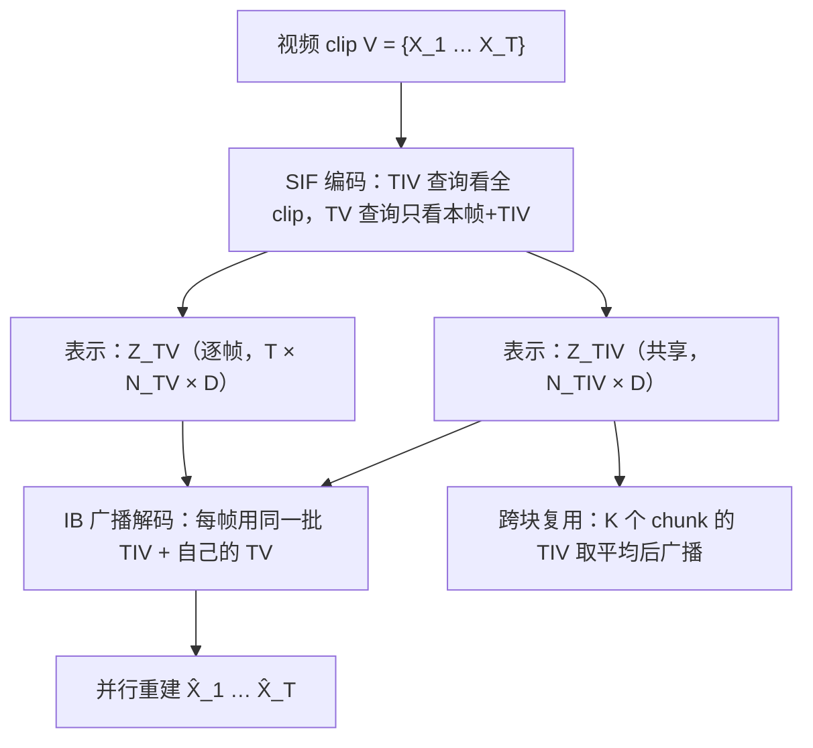
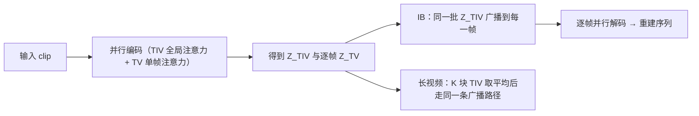

# TivTok

## 论文信息

| 项 | 值 |
|---|---|
| 标题 | TivTok: Broadcasting Time-Invariant Tokens for Scalable Video Tokenization |
| 作者 | Weiliang Chen、Yuanhui Huang、Xuebo Wang、Yueqi Duan |
| 单位 | 清华大学 |
| venue / 年份 | arXiv `2606.17590`（v1 2026-06-16）；**未声明 venue** |
| 代码仓库 | 论文未给出（HTML 未见项目页或代码链接） |
| 关键词 | Video tokenization、Temporal redundancy、Video compression、Video generation、Long video modeling |
| papers 库 | 未入库（frontmatter 只写 `arxiv_id`） |

## 一句话总结

视频里的**持久内容**——背景、一致的外观——本来就在每一帧被重复编码，而且是逐帧重复。TivTok 把这个冗余直接拆掉：一个 clip 用**两组 token** 表示——**TIV**（Time-Invariant，跨帧共享的语义）与 **TV**（Time-Variant，逐帧残差）。分解不是靠监督给出来的，而是靠**编码器的注意力范围**"涌现"出来（TIV 看全 clip、TV 只看本帧）；解码时同一批 TIV 被**广播**到每一帧并行重建，长视频再把各块的 TIV 平均合并后复用。

四条贡献：

1. **TIV / TV 分解**：把"跨帧可复用"与"逐帧残差"显式分成两组 token，并给出信息论动机（节省量随视频长度增长）。
2. **SIF（Scope-Induced Factorization）**：只改注意力范围就得到分解——TIV 查询可见全 clip，TV 查询只见本帧与 TIV；**无需显式分解监督**，也不同于按参考帧/运动掩码/频带的人为切分。
3. **IB（Invariant Broadcasting）**：解码端把同一批 TIV 广播到每一步，与各自 TV 拼接并行解码，把解码复杂度从 $O(T^2)$ 降到 $O(T)$，并顺势支持长视频跨块复用。
4. **端到端验证**：重建、长视频、生成三项都验证了复用带来的效率收益，并给出 TIV 容量与 TIV/TV 分配的两组权衡实验。

## 问题与动机

token 数直接决定生成模型的计算成本与可建模的视频长度，因此主流做法是"把视频压成更少 token"。但论文指出一个被忽略的重复：**持久内容在帧与块之间被反复表示**——静态背景、保持不变的外观，在每一帧里都占着自己的 token。

论文给了一个信息论视角的动机。把视频表示为一个共享成分 $C$ 加上"以 $C$ 为条件的逐帧残差"，则相比逐帧独立编码，被重复编码的信息量是：

$$H_{\text{indep}} - H_{\text{shared}} = \sum_{t=1}^{T} I(X_t; C) - H(C) \;\approx\; (T-1)\,H(C) \;>\; 0$$

| 符号 | 含义 |
|---|---|
| $X_t$ | 第 $t$ 帧 |
| $T$ | 视频帧数 |
| $C$ | 跨帧共享的可复用成分 |
| $H_{\text{indep}}$ | 逐帧独立编码的熵之和 |
| $H_{\text{shared}}$ | 共享成分编码一次 + 逐帧条件残差的总熵 |

近似成立的条件是 $C$ 能从大多数帧里恢复出来；在这个条件下，**节省量随视频长度 $T$ 增长**——这正是长视频收益更大的原因。

## 方法精析

整条链路：**编码器用非对称注意力把 clip 拆成 TIV + TV → 解码器把 TIV 广播回去并行重建 → 长视频再把各块的 TIV 平均合并复用**。

### 前置：holistic visual tokenizer

骨架是基于 ViT 的 SoftVQ-VAE：编码器与解码器各 12 层、隐维 768、patch 大小 `4×8×8`、用 3D RoPE 位置编码。论文的改动只在这个骨架上加**两组 token 与两种注意力范围**，不换骨干。

### 把"跨帧共享"与"逐帧残差"分成两组 token

论文把 clip 的时间不变量理解成一个**可复用成分** $C$——它 informative 于多帧。关键的一句定义是：**这个成分不限于像素级静态内容**，它可以包含场景几何、**物体身份**、以及贯穿序列的一致视觉模式。把这类信息只编码一次并跨帧复用，就只剩下逐帧残差需要单独表示。

两组 token：

- **TIV**：$Z_{\text{TIV}} \in \mathbb{R}^{N_{\text{TIV}} \times D}$，编码所有帧共享的语义结构，可复用到更长的视频；
- **TV**：$Z_{\text{TV}} \in \mathbb{R}^{T \times N_{\text{TV}} \times D}$，保留每一步独有的残差细节。

### SIF：只改注意力范围，就得到分解

编码器的设计原则一句话：**token 的信息流要匹配它的表示角色**。想抓时间不变量的 token 必须能看见整个序列；想抓逐帧残差的 token 必须被阻止吸收跨帧信息。SIF 就是把这件事做成**非对称的注意力范围**：

$$\mathcal{G} = \left[Z_{\text{TIV}},\ Z_{\text{TV}}^{(1)},\dots,Z_{\text{TV}}^{(T)},\ X_1,\dots,X_T\right], \qquad \mathcal{L}_t = \left[Z_{\text{TIV}},\ Z_{\text{TV}}^{(t)},\ X_t\right]$$

| 符号 | 含义 |
|---|---|
| $\mathcal{G}$ | TIV 查询可见的**全局** scope（所有帧 patch + 所有 TV + 所有 TIV） |
| $\mathcal{L}_t$ | 第 $t$ 帧 TV 查询可见的**局部** scope（本帧 patch + 本帧 TV + TIV） |

编码更新就是两组 token 各自在自己的 scope 里做注意力：

$$Z_{\text{TIV}}' = \operatorname{Attn}\!\left(Z_{\text{TIV}},\, \mathcal{G}\right), \qquad Z_{\text{TV}}^{(t)\prime} = \operatorname{Attn}\!\left(Z_{\text{TV}}^{(t)},\, \mathcal{L}_t\right)$$

| 符号 | 含义 |
|---|---|
| $\operatorname{Attn}(A, B)$ | 由 $A$ 提供 query、只用 $B$ 作 key/value 的注意力更新 |

**为什么 TV 不用因果掩码**：论文专门解释了这一点——用因果掩码看起来对自回归生成友好，但它会让 TV token **吸收与 TIV 重叠的跨帧信息**，破坏角色分工；而且会把编码代价抬到 $O(T^2)$。限制 TV 只看单帧后，编码复杂度从 $O\!\left(T^2 (N_{\text{TIV}} + N_{\text{TV}})\right)$ 降到 $O\!\left(T^2 N_{\text{TIV}} + T N_{\text{TV}}\right)$。

**代价要说清**：这也意味着 **TivTok 的编码不是时间因果的**——TIV 必须看见整段 clip 才能聚合共享信息。要接流式管线，这一条是硬约束（后文 §「局限与启发」会与 AdapTok 对照）。

### IB：把同一批 TIV 广播回每一帧

有了跨帧共享的 TIV，解码就不必逐帧串行：把同一批 TIV 广播到每个时间步，与该帧自己的 TV 拼起来解码：

$$\hat{X}_t = D\!\left(\left[Z_{\text{TIV}},\ Z_{\text{TV}}^{(t)}\right]\right), \qquad t = 1,\dots,T$$

| 符号 | 含义 |
|---|---|
| $D(\cdot)$ | transformer 解码器 |
| $\hat{X}_t$ | 第 $t$ 帧的重建 |

因为每一帧的解码只依赖"共享的 TIV + 自己的 TV"，**所有帧可以并行解码**，解码复杂度从 $O(T^2)$ 降到 $O(T)$。

### 跨块复用：长视频把 TIV 平均合并

同一套复用逻辑可以推到 chunk 级别：一段 $K$ 块的长视频里，有些持久内容跨块也是共享的，逐块各存一份 TIV 同样是重复。做法是把 $K$ 个 chunk 并行编码后，**把各自的 TIV 取平均**合并成一份：

$$\bar{Z}_{\text{TIV}} = \frac{1}{K}\sum_{i=1}^{K} Z_{\text{TIV}}^{(i)}$$

| 符号 | 含义 |
|---|---|
| $K$ | chunk 数 |
| $Z_{\text{TIV}}^{(i)}$ | 第 $i$ 块的 TIV |
| $\bar{Z}_{\text{TIV}}$ | 合并后的全局 TIV，解码时按 IB 广播到所有块的所有帧 |

论文列出三个好处：消除跨块的冗余 TIV 从而降低 token 总数；chunk 维度的复杂度从 $O(K^2)$ 降到 $O(K)$；训练时有效序列变短、更易优化。

## 训练与实现细节

| 项 | 值 |
|---|---|
| 骨干 | ViT-based SoftVQ-VAE；编解码各 12 层、隐维 768、patch `4×8×8`、3D RoPE |
| 数据集 | UCF-101 与 K600 的混合（生成侧另用 UCF-101 类条件） |
| 分辨率 | tokenizer 训练与主评测 `256×256`；TIV 容量/分配实验在 `128×256×256` |
| 训练轮数 / 步数 | 100K iterations（tokenizer）；长视频跨块复用**额外 50K** iterations；生成模型 100K iterations |
| 优化器 / 学习率 | AdamW，weight decay $10^{-4}$，$(\beta_1,\beta_2)=(0.9,0.95)$，global batch 64，base lr $10^{-4}$，5K warmup，cosine 衰减 |
| 数据增强 | 水平翻转 + 中心裁剪 |
| 损失函数 | $\mathcal{L} = \mathcal{L}_{\text{recon}} + \lambda_1 \mathcal{L}_{\text{percept}} + \lambda_2 \lambda_\nabla \mathcal{L}_{\text{adv}}$，$\lambda_1 = 1$、$\lambda_2 = 0.2$；DINOv2-S 判别器自 30K 迭代起启用；LeCAM 正则 0.001 |
| 自适应权重 | $\lambda_\nabla = \dfrac{\nabla_\phi(\mathcal{L}_{\text{recon}} + \lambda_1\mathcal{L}_{\text{percept}})}{\nabla_\phi \mathcal{L}_{\text{adv}}}$，让对抗项与重建/感知项量级对齐 |
| 生成侧配置 | LightningDiT 适配：隐维 1152、28 层、16 头、patch 1、绝对位置编码、batch 512、lr $10^{-4}$ 常数；推理 Euler 采样 50 步、CFG 区间起点 0.1、timestamp shift 2 |
| 硬件 / 成本 | **未披露** |
| 随机种子 / 复现 | **未披露**；论文未给代码仓库 |

## 推理与系统链路

三个复杂度读数（论文明确给出）：

| 环节 | 复杂度变化 |
|---|---|
| 编码 | $O\!\left(T^2(N_{\text{TIV}}+N_{\text{TV}})\right) \rightarrow O\!\left(T^2 N_{\text{TIV}} + T N_{\text{TV}}\right)$ |
| 解码 | $O(T^2) \rightarrow O(T)$ |
| 跨块 | $O(K^2) \rightarrow O(K)$ |

延迟（取自长视频实验表）：`32×256×256` 下 TivTok-T128 = **0.20 s**（对照 CV-VAE 1.78 s、LARP 1.75 s）；`128×256×256` 下 TivTok-T128 = **0.71 s**（对照 CV-VAE 7.12 s、LARP 22.78 s）。

**一个必须记住的约束**：这里的"并行"是**编码与解码都可以并行**，靠的是 TIV 看全 clip；因此 **TivTok 不是因果 tokenizer**，接流式应用时需要额外的改造（或改用因果 tokenizer，如 AdapTok）。

## 实验与结果

分辨率口径：主重建表是 `16×256×256`；TIV 容量与分配实验是 `128×256×256`；长视频表含 `32×256×256` 与 `128×256×256` 两档。**不同表之间不可横比。**

### 重建（UCF-101，16×256×256）

| 类别 | 方法 | #token | #dim | T/P (%) ↓ | PSNR ↑ | SSIM ↑ | LPIPS ↓ | rFVD ↓ |
|---|---|---|---|---|---|---|---|---|
| Downsample | SDXL-VAE | 16384 | 4 | 1.563 | – | – | – | 23.68 |
| Downsample | OpenSora | 4096 | 16 | 0.391 | – | – | – | 67.52 |
| Downsample | Cosmos-M | 2048 | 16 | 0.195 | 31.70 | 0.9177 | 0.0575 | 13.67 |
| Downsample | Cosmos-S | 512 | 16 | 0.049 | 28.26 | 0.8577 | 0.1046 | 104.51 |
| Downsample | CV-VAE | 4096 | 4 | 0.391 | 29.47 | 0.8849 | 0.0685 | 52.43 |
| Holistic | LARP | 1024 | 16 | 0.391 | 28.65 | 0.9003 | 0.0425 | 23.93 |
| Holistic | LARP | 1024 | 16 | 0.098 | 25.53 | 0.8262 | 0.0973 | 51.45 |
| Holistic | ElasticTok | 1024 | 16 | 0.391 | – | – | – | 390 |
| Holistic | AdapTok | 2048 | 16 | 0.781 | 26.38 | 0.8539 | 0.0599 | 27.97 |
| 分解式 | Omni | 4096 | 8 | 0.391 | 29.34 | 0.9250 | 0.0487 | 14.53 |
| 分解式 | Omni-DV | 4096 | 8 | 0.391 | 28.06 | 0.9095 | 0.0637 | 27.12 |
| 分解式 | VidTwin | 1008 | 4/8 | 0.126 | 28.14 | 0.8044 | 0.2414 | 388.86 |
| **分解式** | **TivTok-T128** | **128** | **128** | **0.012** | 30.13 | 0.9010 | 0.0614 | **21.29** |
| **分解式** | **TivTok-T512** | **512** | **32** | **0.049** | **30.26** | 0.8982 | **0.0533** | **12.65** |
| **分解式** | **TivTok-T1024** | 1024 | 16 | 0.098 | 29.54 | 0.8897 | 0.0607 | 17.97 |

读法：**TivTok-T512 拿到该分辨率下的最低 rFVD（12.65）**，而 token-to-pixel 比只有 0.049%；TivTok-T128 更极端——128 个 token、T/P 0.012%，仍有 21.29 的 rFVD。三档差异不大，说明框架在"token 数 × 维度"这个权衡面上比较稳定。论文把相对分解式基线的优势归因于 **TIV/TV 是涌现的**：不像"运动""高频"这类预设定义，SIF 学到的是视频自适应的不变量。

### TIV 到底学了什么（本节是全文对我们最有价值的部分）

论文用一个**像素交集基线**做对照：只保留跨帧像素变化极小的区域（图 5 红框），如果 TIV 只是编码"静态像素"，它的重建应该与这些交集接近。结果不是。

两个例子：在广告牌位置随时间变化、两名滑冰者保持一致的片段里，**TIV 忠实抓到了滑冰者的外观与服装纹理**，而不是像素稳定的背景；在台球例子里，静止的球进 TIV、运动的球归 TV。

论文由此给出一个必须原样引用的判断：**这不是前景/背景或运动/静止的划分**——**一个运动的物体，只要它的身份与外观保持稳定，仍然可以被分到不变量分支，而 TV token 只需要描述姿态、位置等瞬态变化**。这个性质也让 SIF 区别于按参考帧、运动掩码或频带的人手切分。

### 长视频

| 分辨率 | 方法 | #token | 延迟 (s) ↓ | PSNR ↑ | SSIM ↑ | LPIPS ↓ | rFVD ↓ |
|---|---|---|---|---|---|---|---|
| 32×256×256 | CV-VAE | 8192 | 1.78 | 29.12 | 0.8809 | 0.0692 | 64.21 |
| 32×256×256 | LARP | 2048 | 1.75 | 23.15 | 0.7479 | 0.1757 | 226.79 |
| 32×256×256 | TivTok-T128 | **160** | **0.20** | 29.05 | 0.8831 | 0.0719 | 38.49 |
| 32×256×256 | TivTok-T512 | 640 | – | 30.25 | 0.8948 | 0.0591 | **23.26** |
| 32×256×256 | TivTok-T1024 | 1280 | – | 29.13 | 0.8857 | 0.0711 | 61.46 |
| 128×256×256 | CV-VAE | 32768 | 7.12 | 29.00 | 0.8831 | 0.0729 | **72.91** |
| 128×256×256 | LARP | 8192 | 22.78 | 14.85 | 0.2924 | 0.6251 | 3223.55 |
| 128×256×256 | CoordTok（128³） | 1280 | – | 27.25 | 0.7503 | 0.2346 | 1108.76 |
| 128×256×256 | TivTok-T128 | **352** | **0.71** | 26.23 | 0.8210 | 0.1057 | 92.09 |

论文报告：128 帧视频的压缩效率比所评基线高 **2.91×**；downsample 类质量稳定但 token 数随长度线性增长，holistic 类（LARP）token 更少但质量与延迟都退化。TivTok 的 token 数基本不随长度增长（T128 从 160 到 352），延迟也是这一档里最低的。

### 生成（UCF-101 类条件）

| 长度 | 方法 | #token | 每步耗时 (s) ↓ | 显存 (GB) ↓ | TFLOPs ↓ | FVD ↓ |
|---|---|---|---|---|---|---|
| 16 | Cosmos-S | 512 | 0.047 | 2.62 | 0.49 | 191 |
| 16 | Omni | 4096 | 0.437 | 4.69 | 5.82 | 191 |
| 16 | LARP | 1024 | 0.083 | 2.73 | 1.05 | 107 |
| 16 | CV-VAE | 4096 | 0.437 | 4.69 | 5.82 | 262 |
| 16 | **TivTok-T1024** | 1024 | 0.083 | 2.73 | 1.05 | **99** |
| 16 | TivTok-T512 | 512 | 0.047 | 2.62 | 0.49 | 101 |
| 16 | TivTok-T128 | 128 | 0.021 | 2.58 | 0.12 | 149 |
| 32 | CV-VAE | 8192 | 1.261 | 10.82 | 15.97 | 370 |
| 32 | **TivTok-T128** | 160 | **0.021** | **2.58** | **0.15** | **300** |
| 128 | MALT\* | 4096 | – | – | – | 220 |
| 128 | CoordTok+SiT-L/2\* | 1280 | – | – | – | 369 |
| 128 | **TivTok-T128**\* | 352 | 0.031 | 2.60 | 0.33 | **208** |

> `\*` 标注的是 `128×128×128` 分辨率；此外 MALT 一行取自 MALT 论文的转引。**这几行的数字不能与 `256×256` 的行直接横比。**

### TIV 容量与 TIV:TV 分配（128×256×256）

| TIV 数量 | #token | #dim | 压缩率 (%) ↓ | PSNR ↑ | SSIM ↑ | LPIPS ↓ | rFVD ↓ |
|---|---|---|---|---|---|---|---|
| CV-VAE（基线） | 32768 | 4 | 0.521 | 29.00 | 0.8831 | 0.0729 | 72.91 |
| 8 | 1024 | 128 | 0.521 | **30.07** | **0.9003** | **0.0618** | **28.96** |
| 4 | 640 | 128 | 0.326 | 28.97 | 0.8825 | 0.0739 | 39.84 |
| 2 | 448 | 128 | 0.228 | 27.20 | 0.8453 | 0.0951 | 81.18 |
| 1 | 352 | 128 | 0.179 | 26.23 | 0.8210 | 0.1057 | 92.09 |

| TIV:TV | 压缩率 (%) ↓ | PSNR ↑ | SSIM ↑ | LPIPS ↓ | rFVD ↓ |
|---|---|---|---|---|---|
| CV-VAE（基线） | 0.521 | 29.00 | 0.8831 | 0.0729 | 72.91 |
| 1:3 | 0.318 | 28.24 | 0.8663 | 0.0761 | 41.33 |
| 1:1 | 0.229 | 27.52 | 0.8503 | 0.0887 | 64.76 |
| 3:1 | 0.179 | 26.23 | 0.8210 | 0.1057 | 92.09 |

这两张表是一对：**给 TIV 多少容量、以及 TIV 与 TV 怎么分**。结论是"给够不变量容量以抓住可复用语义，同时留足 TV 容量描述快速变化的残差"——给 TIV 越多，长视频压缩越紧凑；给 TV 越多，逐帧细节越好。

## 相关工作与定位

| 脉络 | 代表 | 与本文的关系 |
|---|---|---|
| 图像 tokenizer → 视频 tokenizer | VQGAN/ViT-VQGAN → MAGVIT、OmniTokenizer、Cosmos-Tokenizer 等 | 本文沿用其离散化框架（SoftVQ-VAE），改的是 token 的角色划分 |
| 分解式视频 tokenizer | 按参考帧、运动掩码、频带切分的做法（如 VidTwin 一类） | 本文的根本差别：**分量是涌现的**，不是预设"运动/高频/静态" |
| 长视频 / 高效 tokenization | CoordTok 一类 | 本文的跨块 TIV 复用与其目标相同（减少随长度的 token 增长），机制不同 |

定位一句话：**本文的贡献不在"压得更狠"，而在"把可复用的部分识别出来并跨时间复用"**。

## 局限与启发

### 论文自己承认的局限

- **复用假设会变弱**：遇到突兀的场景切换、高度非平稳的相机运动、快速变化的物体、或几乎没有持久内容时，能安全跨时间共享的 token 变少，广播的收益下降。
- **未与更大的下游生成模型联合优化**：论文把这留作未来工作（本文的生成实验用的是自己适配的 LightningDiT）。

### 我们需要注意的口径

- **编码不是时间因果的**：TIV 必须看见整段 clip；论文还解释了为什么 TV 不用因果掩码。这是"能不能接流式"的第一道门槛。
- 跨块复用的是 **TIV 平均**（式 6），场景切换时平均会稀释信息——与上面第一条局限是同一件事的两面。
- 主表有 `256×256`、`128×256×256`、`128×128×128` 三种分辨率，生成表里还有一行是**转引自 MALT**。
- 未披露训练硬件与随机种子，也没有代码。

### 与数字人的关系（本篇的主要增值）

我们关心的是**能不能用视频 token 来承载数字人的身份表示**。TivTok 在这个问题上第一次给了一个**机制上的正面答案**，但只是机制层面：

| 维度 | TivTok 的情况 |
|---|---|
| **身份—运动解耦** | ✅ **有专用机制**：TIV（跨帧共享语义，论文明确包含"物体身份"）/ TV（姿态、位置等瞬变）的分工是架构涌现的，而且论文明确说**运动物体只要身份稳定也可进 TIV** |
| **因果性** | ❌ **编码非时间因果**：TIV 看全 clip、TV 单帧可见；与 AdapTok 的块级因果正面相反 |
| 可控性 | ⚠️ 可通过 TIV 数量与 TIV:TV 比例间接调节容量分配（§4.6 两组实验就是这件事），没有语义级控制接口 |
| 判别/身份监督 | ❌ 没有：训练目标是重建 + 感知 + 对抗，无任何判别监督 |
| 可比性 | ❌ 未知：token 距离是否单调代理身份失配，论文没有涉及 |

由此，它与我们正在评估的另一篇**正好互补**：

- **TivTok 给"解耦"**（TIV 承载跨帧不变的身份/外观），但**编码非因果**；
- **AdapTok 给"因果与预算"**（块级因果 + 按内容密度分配 token），但**没有解耦机制**；
- **Face Vid2vid 提供参照基线**（从**单张图**提身份），回答"视频 token 到底比单图多给了什么"。

三条待验证判据（与第七章首条目的设计一致，此处按本篇特性具体化）：

1. **TIV 的身份纯度**：把 TIV 换成另一段视频的、保持 TV 不变，看身份是否随之改变、背景是否也跟着变——用来分解 TIV 里"身份"与"场景"各占多少。论文的滑冰者例子说明它**可能**主要抓人物外观，但没有量化。
2. **跨条件可比性**：同一段视频的不同片段、同一角色的不同视频，TIV 表示的距离分布是否可分。
3. **时序可用性**：若要做流式，需要评估"整段编码 + 广播解码"改造成因果形式后会损失多少质量（论文没有做这个消融）。

需要强调的边界：论文的"物体身份进 TIV"是**定性结论**（可视化示例），不是身份判别的量化结果；TIV 的语义里同时含场景几何与背景，**TIV ≠ 身份**。把它当身份表示使用之前，上面三条判据必须先跑。

### 可操作启发

- **"跨帧共享 + 逐帧残差"这个二分比"运动/静止"更接近数字人需要的语义**：我们要保住的正是"身份与外观稳定、姿态与位置可变"，而 TIV/TV 的分工恰好是这个二分。这一点在设计我们自己的身份表示时可以借用。
- **只改注意力范围就能得到分解**——这个工程手法成本极低：不需要分解标签、不需要额外损失项，只要控制两组 token 的可见范围。
- **复用要付出非因果的代价**：TIV 必须看到整段，因而无法流式。若要用它的思想做实时，需要把"全局 TIV"换成"跨块递推的 TIV 状态"，这是一个明确的改造方向。
- **容量分配是可调的旋钮**：TIV 数量与 TIV:TV 比例直接决定"身份容量 vs 细节容量"的取舍，§4.6 的两组表提供了现成的实验范式。

## 术语与符号表

| 术语 | 英文 | 含义 |
|---|---|---|
| 时间不变 token | Time-Invariant token（TIV） | 编码跨帧共享语义、可跨帧跨块复用的 token |
| 时间变化 token | Time-Variant token（TV） | 编码逐帧残差的 token |
| 范围诱导分解 | Scope-Induced Factorization（SIF） | 用非对称注意力范围实现分解的编码器设计 |
| 不变广播 | Invariant Broadcasting（IB） | 解码时把同一批 TIV 广播到每一帧 |
| 像素持久性 | pixel-level persistence | 跨帧像素变化极小的区域（论文的对照基线） |
| 语义不变性 | semantic invariance | 跨帧稳定的语义结构（TIV 实际抓的东西） |
| token-to-pixel 比 | T/P (%) | token 数与像素数之比，越低越省 |

| 符号 | 含义 |
|---|---|
| $X_t$ | 第 $t$ 帧 |
| $T$ / $K$ | clip 帧数 / chunk 数 |
| $C$ | 跨帧共享的可复用成分 |
| $Z_{\text{TIV}}$ / $\bar{Z}_{\text{TIV}}$ | TIV token / 跨块平均合并后的 TIV |
| $Z_{\text{TV}}^{(t)}$ | 第 $t$ 帧的 TV token |
| $N_{\text{TIV}}$ / $N_{\text{TV}}$ / $D$ | TIV 个数 / 每帧 TV 个数 / 隐维 |
| $\mathcal{G}$ / $\mathcal{L}_t$ | TIV 可见的全局 scope / TV 可见的帧局部 scope |
| $\hat{X}_t$ | 重建的第 $t$ 帧 |

**四处易错命名**：TIV 是"**时间**不变"不是"**像素**不变"；SIF 是**编码器**的注意力范围设计、IB 是**解码器**的广播复用；T128/T512/T1024 指的是 TV 档位（每 clip 的 token 规模与维度组合），与"TIV 数量"是两件不同的事；TivTok 的"并行"是**编码与解码都可并行**，代价是**非因果**。

## 相关文档

- [[数字人概述/数字人领域问题|数字人领域问题]]（第七章「技术适用性」首条目的两篇素材之一）
- [[论文笔记/adaptok|AdapTok 模型笔记]]（**成对**：AdapTok 给因果与自适应预算，TivTok 给不变/变分分解）
- [[论文笔记/face-vid2vid|Face Vid2vid 模型笔记]]（**成对**：从单张图提身份，作为"视频 token 提身份"的参照基线）
- [[论文笔记/causal-forcing|Causal Forcing 模型笔记]]
- [[数字人概述/数字人身份|数字人身份]]（selective sensitivity 判据与漂移诊断所在）
